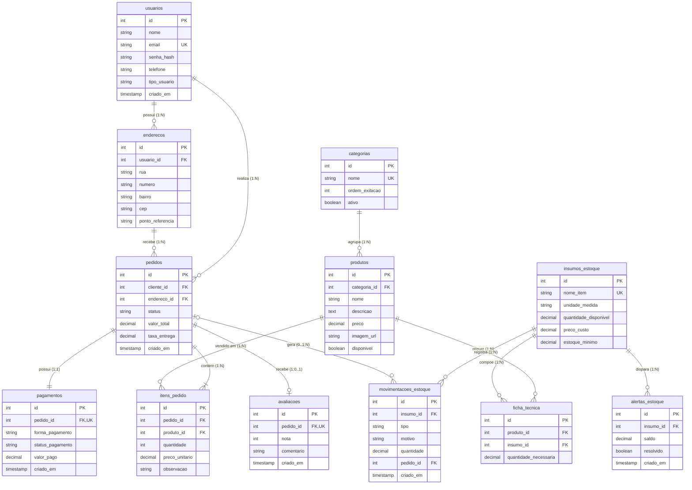
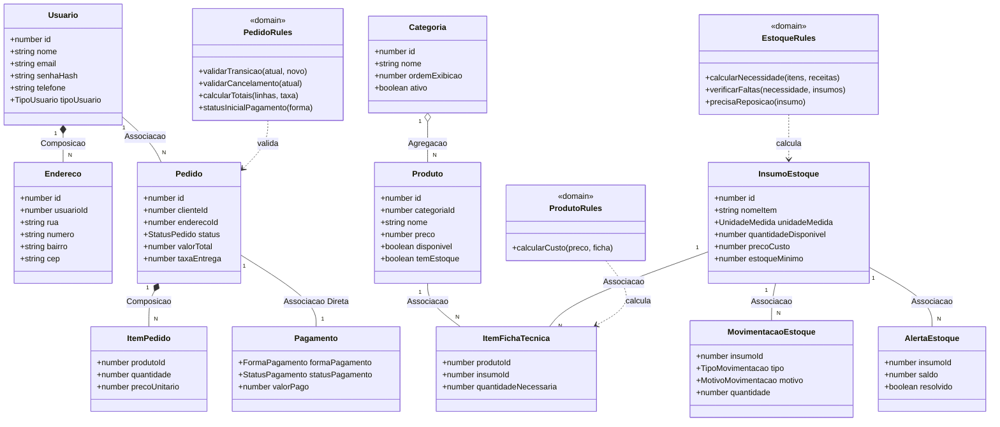

# BurguerSabor — Modelagem de Banco de Dados (DER), Dicionário de Dados e Diagrama de Classes UML

O modelo tem 12 tabelas e está normalizado até a **3ª Forma Normal**: cada tabela guarda um único assunto, todo atributo depende só da
chave primária, e nada que possa ser calculado é repetido (o total de um item é `quantidade × preco_unitario`; o lucro
de um produto é calculado pela ficha técnica). A única cópia intencional é `itens_pedido.preco_unitario`, que guarda o
**preço histórico** do dia da compra (RF06): ele é um fato do pedido, não uma repetição do preço atual.

Scripts executáveis: [`database/schema.sql`](../database/schema.sql) (DDL + índices) e
[`database/seed.sql`](../database/seed.sql) (dados de teste).

## Modelo conceitual e lógico (DER)

## Dicionário de dados

Convenções: `SERIAL` = inteiro com numeração automática; `DECIMAL(10,2)` = número com 2 casas (dinheiro e
quantidades); toda FK tem comportamento explícito de exclusão (RNF02).

### usuarios — contas de clientes e administradores (RF01)

| Coluna | Tipo | Restrições | Descrição |
|---|---|---|---|
| id | SERIAL | PK | Identificador |
| nome | VARCHAR(100) | NOT NULL | Nome da pessoa |
| email | VARCHAR(150) | NOT NULL, UNIQUE | Login; não se repete |
| senha_hash | VARCHAR(255) | NOT NULL | Hash Bcrypt com salt (RNF01); a senha nunca é gravada |
| telefone | VARCHAR(20) | NOT NULL | Celular com DDD |
| tipo_usuario | VARCHAR(20) | NOT NULL, CHECK em (CLIENTE, ADMIN) | Perfil de acesso (RBAC) |
| criado_em | TIMESTAMP | DEFAULT agora | Data do cadastro |

### enderecos — endereços de entrega do cliente (RF02, 1:N)

| Coluna | Tipo | Restrições | Descrição |
|---|---|---|---|
| id | SERIAL | PK | Identificador |
| usuario_id | INT | NOT NULL, FK → usuarios ON DELETE CASCADE | Dono do endereço |
| rua, numero, bairro | VARCHAR | NOT NULL | Logradouro |
| cep | VARCHAR(9) | NOT NULL | Formato 00000-000 (validado na API) |
| ponto_referencia | VARCHAR(150) | — | Opcional |

### categorias — grupos do cardápio

| Coluna | Tipo | Restrições | Descrição |
|---|---|---|---|
| id | SERIAL | PK | Identificador |
| nome | VARCHAR(50) | NOT NULL, UNIQUE | Ex.: Hambúrgueres |
| ordem_exibicao | INT | NOT NULL, DEFAULT 0 | Posição na barra de categorias |
| ativo | BOOLEAN | NOT NULL, DEFAULT TRUE | Categoria inativa some do cardápio |

### produtos — itens à venda (RF03)

| Coluna | Tipo | Restrições | Descrição |
|---|---|---|---|
| id | SERIAL | PK | Identificador |
| categoria_id | INT | NOT NULL, FK → categorias ON DELETE RESTRICT | Categoria obrigatória (RN03) |
| nome | VARCHAR(100) | NOT NULL | Nome no cardápio |
| descricao | TEXT | — | Opcional |
| preco | DECIMAL(10,2) | NOT NULL, CHECK > 0 | Preço de venda (RN02) |
| imagem_url | VARCHAR(255) | — | Opcional |
| disponivel | BOOLEAN | NOT NULL, DEFAULT TRUE | Liga/desliga no cardápio |

### insumos_estoque — ingredientes e materiais (RF04)

| Coluna | Tipo | Restrições | Descrição |
|---|---|---|---|
| id | SERIAL | PK | Identificador |
| nome_item | VARCHAR(100) | NOT NULL, UNIQUE | Ex.: Pão Brioche |
| unidade_medida | VARCHAR(10) | NOT NULL, CHECK em (UN, KG, L, G, ML) | Unidade do saldo |
| quantidade_disponivel | DECIMAL(10,2) | NOT NULL, CHECK >= 0 | Saldo; nunca negativo (RN01) |
| preco_custo | DECIMAL(10,2) | NOT NULL, CHECK > 0 | Quanto a loja paga por unidade |
| estoque_minimo | DECIMAL(10,2) | NOT NULL, DEFAULT 0, CHECK >= 0 | Saldo que dispara o alerta de reposição |

### ficha_tecnica — receita: produto × insumo (RF04, N:N)

| Coluna | Tipo | Restrições | Descrição |
|---|---|---|---|
| id | SERIAL | PK | Identificador |
| produto_id | INT | NOT NULL, FK → produtos ON DELETE CASCADE | Produto |
| insumo_id | INT | NOT NULL, FK → insumos_estoque ON DELETE RESTRICT | Insumo usado |
| quantidade_necessaria | DECIMAL(10,2) | NOT NULL, CHECK > 0 | Quanto sai por porção (RN02) |
| (produto_id, insumo_id) | — | UNIQUE | Um insumo aparece uma vez por receita |

### pedidos — pedidos do cliente (RF06, RF07)

| Coluna | Tipo | Restrições | Descrição |
|---|---|---|---|
| id | SERIAL | PK | Identificador |
| cliente_id | INT | NOT NULL, FK → usuarios ON DELETE RESTRICT | Quem pediu |
| endereco_id | INT | NOT NULL, FK → enderecos ON DELETE RESTRICT | Onde entregar |
| status | VARCHAR(30) | NOT NULL, DEFAULT RECEBIDO, CHECK no fluxo | RECEBIDO → PREPARANDO → SAIU_ENTREGA → CONCLUIDO, ou CANCELADO |
| valor_total | DECIMAL(10,2) | NOT NULL, CHECK >= 0 | Itens + taxa de entrega |
| taxa_entrega | DECIMAL(10,2) | NOT NULL, DEFAULT 0, CHECK >= 0 | Taxa cobrada |
| criado_em | TIMESTAMP | DEFAULT agora | Momento do pedido |

### itens_pedido — o que há em cada pedido (1:N)

| Coluna | Tipo | Restrições | Descrição |
|---|---|---|---|
| id | SERIAL | PK | Identificador |
| pedido_id | INT | NOT NULL, FK → pedidos ON DELETE CASCADE | Pedido |
| produto_id | INT | NOT NULL, FK → produtos ON DELETE RESTRICT | Produto vendido (não pode ser apagado depois) |
| quantidade | INT | NOT NULL, CHECK > 0 | Unidades |
| preco_unitario | DECIMAL(10,2) | NOT NULL, CHECK > 0 | Preço histórico do dia (RF06) |
| observacao | VARCHAR(200) | — | Ex.: sem cebola |

### pagamentos — pagamento do pedido (RF08, 1:1)

| Coluna | Tipo | Restrições | Descrição |
|---|---|---|---|
| id | SERIAL | PK | Identificador |
| pedido_id | INT | NOT NULL, UNIQUE, FK → pedidos ON DELETE CASCADE | UNIQUE garante 1 pagamento por pedido |
| forma_pagamento | VARCHAR(30) | NOT NULL, CHECK em (PIX, CARTAO_CREDITO, CARTAO_DEBITO, DINHEIRO) | Forma escolhida |
| status_pagamento | VARCHAR(30) | NOT NULL, DEFAULT PENDENTE, CHECK em (PENDENTE, APROVADO, RECUSADO) | Simulado: Pix/cartão aprovados na hora; dinheiro na entrega; cancelado = RECUSADO |
| valor_pago | DECIMAL(10,2) | NOT NULL, CHECK > 0 | Valor do pedido |
| criado_em | TIMESTAMP | DEFAULT agora | Momento do pagamento |

### movimentacoes_estoque — extrato de entradas e saídas

| Coluna | Tipo | Restrições | Descrição |
|---|---|---|---|
| id | SERIAL | PK | Identificador |
| insumo_id | INT | NOT NULL, FK → insumos_estoque ON DELETE RESTRICT | Insumo movimentado |
| tipo | VARCHAR(10) | NOT NULL, CHECK em (ENTRADA, SAIDA) | Direção |
| motivo | VARCHAR(20) | NOT NULL, CHECK em (PEDIDO, CANCELAMENTO, REPOSICAO, CADASTRO) | Por que mudou |
| quantidade | DECIMAL(10,2) | NOT NULL, CHECK > 0 | Quanto mudou |
| pedido_id | INT | FK → pedidos ON DELETE SET NULL | Pedido que causou a baixa, se houver |
| criado_em | TIMESTAMP | DEFAULT agora | Quando |

### alertas_estoque — avisos de reposição para o admin

| Coluna | Tipo | Restrições | Descrição |
|---|---|---|---|
| id | SERIAL | PK | Identificador |
| insumo_id | INT | NOT NULL, FK → insumos_estoque ON DELETE CASCADE | Insumo que chegou ao mínimo |
| saldo | DECIMAL(10,2) | NOT NULL | Saldo no momento do alerta |
| resolvido | BOOLEAN | NOT NULL, DEFAULT FALSE | Fecha sozinho na reposição |
| criado_em | TIMESTAMP | DEFAULT agora | Quando |
| (insumo_id) WHERE resolvido = FALSE | — | UNIQUE parcial | No máximo 1 alerta aberto por insumo |

### avaliacoes — nota do cliente para o pedido entregue (1:0..1)

| Coluna | Tipo | Restrições | Descrição |
|---|---|---|---|
| id | SERIAL | PK | Identificador |
| pedido_id | INT | NOT NULL, UNIQUE, FK → pedidos ON DELETE CASCADE | Cada pedido recebe no máximo uma avaliação |
| nota | INT | NOT NULL, CHECK entre 1 e 5 | Estrelas |
| comentario | VARCHAR(300) | — | Opcional |
| criado_em | TIMESTAMP | DEFAULT agora | Quando |

A API só aceita avaliação de pedido com status CONCLUIDO, feita pelo próprio cliente. A média aparece no topo da loja.

### Índices

| Índice | Para quê |
|---|---|
| idx_produtos_categoria, idx_ficha_tecnica_produto | Montar o cardápio e a receita |
| idx_pedidos_cliente, idx_pedidos_status | "Meus pedidos" e a fila da cozinha por status |
| idx_itens_pedido_pedido, idx_enderecos_usuario | Carregar itens e endereços |
| idx_movimentacoes_insumo, idx_movimentacoes_pedido | Extrato por insumo e baixas de um pedido |
| ux_alerta_aberto_insumo | Impedir alertas duplicados |

## Diagrama de classes (camada de domínio da API)

As regras de negócio ficam em funções puras de domínio (`backend/src/domain/*.rules.ts`), sem banco e sem HTTP, e são
usadas pelos Services. Por isso os métodos do UML original (`abaterEstoque`, `calcularTotal`, `atualizarStatus`...)
aparecem aqui como funções de regra.
